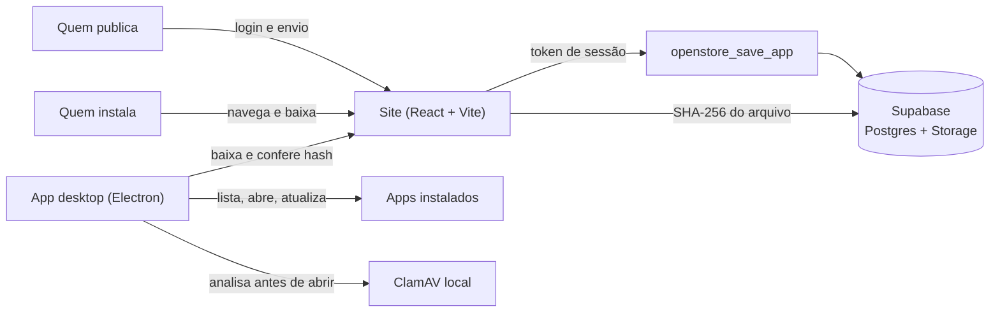

<div align="center">


# OpenStore

**A loja aberta de aplicativos.** Qualquer pessoa publica o seu programa, qualquer pessoa instala —
com o download certo para o sistema dela.

[](https://github.com/zinvoid/OpenStore/releases/latest)
[](https://github.com/zinvoid/OpenStore/releases)
[](LICENSE)
[](https://openstore-ashen.vercel.app)

[**Abrir a loja**](https://openstore-ashen.vercel.app) · [**Baixar o app**](https://github.com/zinvoid/OpenStore/releases/latest) · [**Ver o código**](#-estrutura-do-projeto)

</div>

---

## Por que existe

Lojas de aplicativos costumam ser fechadas: alguém decide o que entra, alguém cobra a taxa e alguém escolhe
qual versão você recebe. A OpenStore inverte isso — o catálogo é da comunidade, a publicação é gratuita e o
arquivo entregue é sempre o do seu sistema, verificado antes de rodar.

| **Parte** | **Site** | **App desktop** |
| :-- | :-- | :-- |
| **O que é** | Loja e landing page públicas | Gerenciador dos apps instalados |
| **Stack** | React 19 · Vite 7 · Tailwind 4 | Electron 38 · electron-builder |
| **Faz** | Publicar, buscar, avaliar, baixar | Abrir, mover, atualizar, desinstalar, analisar |

## Destaques

- **Download no formato certo.** A loja identifica o sistema e entrega `.exe`, `.AppImage` ou `.deb` — sem
  o usuário escolher entre binários que não vão rodar.
- **Publicação sem intermediário.** Conta com sessão por token, envio do instalador pelo navegador e página
  do app gerada na hora. Nenhuma aprovação manual, nenhuma comissão.
- **Integridade verificada.** O SHA-256 do arquivo é calculado no navegador e registrado; o app desktop
  confere o hash e passa o instalador pelo **ClamAV** da máquina antes de qualquer execução.
- **Interface Liquid Glass.** Camadas translúcidas com saturação, reflexo e sombra suave, em tema claro e
  escuro — vidro de verdade, não um gradiente roxo.
- **Tudo aberto.** Código MIT, banco em Postgres e instaladores gerados por GitHub Actions a cada tag.

## Instalação

Baixe em **[Releases](https://github.com/zinvoid/OpenStore/releases/latest)** — a versão disponível aparece
no topo deste README.

| Sistema | Arquivo | Como usar |
| :-- | :-- | :-- |
| **Windows 10/11** | `OpenStore.Setup.<versão>.exe` | Instalador (escolhe a pasta, cria atalhos) |
| **Windows portátil** | `OpenStore-<versão>-portable.exe` | Executa sem instalar |
| **Linux** | `OpenStore-<versão>-x86_64.AppImage` | `chmod +x` e execute |
| **Linux (Debian/Ubuntu)** | `OpenStore-<versão>-amd64.deb` | `sudo apt install ./OpenStore-<versão>-amd64.deb` |
| **macOS** | — | Em desenvolvimento ([roadmap](#-roadmap)) |

> O app avisa quando existe versão nova e oferece a atualização dentro da própria interface.

## Como funciona



O site é uma SPA com uma landing pública e a loja em `#/home`. O app desktop é a mesma interface rodando
dentro do Electron, com uma camada extra (`electron/main.cjs`) que conversa com o sistema: detecta o
executável instalado, move a instalação, revela a pasta, troca de versão e desinstala.

## Rodando localmente

**Pré-requisitos:** Node.js 22+ e npm. O app desktop precisa ainda de um ambiente gráfico; o ClamAV é
opcional (sem ele, a loja avisa em vez de fingir que analisou o arquivo).

```bash
npm install
cp .env.example .env    # preencha VITE_SUPABASE_URL e VITE_SUPABASE_ANON_KEY
npm run dev             # site em http://127.0.0.1:5173
npm run electron:dev    # site + app desktop
```

| Script | O que faz |
| :-- | :-- |
| `npm run dev` | Servidor de desenvolvimento do site |
| `npm run electron:dev` | Vite + Electron em modo desenvolvimento |
| `npm run build` | Build de produção do site em `dist/` |
| `npm run typecheck` | Checagem de tipos (`tsc --noEmit`) |
| `npm run dist:win` | Instalador NSIS + portátil x64 em `release/` |

## Estrutura do projeto

```text
OpenStore/
├─ src/                 # Interface (React + Tailwind)
│  ├─ pages/            # Landing, Home, Browse, AppDetail, Publish, Library, SignIn
│  ├─ components/       # Shell, navegação, cards, marca e ícones
│  ├─ lib/              # Supabase, sessão, ponte com o desktop, releases, tema
│  └─ index.css         # Sistema visual: tokens de vidro, tema claro/escuro
├─ electron/            # Processo principal e preload (instalar, abrir, mover, desinstalar)
├─ supabase/            # SQL aplicado em ordem no projeto
├─ scripts/             # Ícones, SQL via Management API e canal de releases
├─ build/               # Ícones do app (.png, .ico) e arte original
└─ .github/workflows/   # Release automática a cada tag v*
```

## Banco de dados

Os arquivos de `supabase/` são aplicados em ordem:

| Arquivo | Conteúdo |
| :-- | :-- |
| `schema.sql` | Apps, downloads, avaliações e buckets de Storage |
| `accounts.sql` | Contas com senha em hash bcrypt |
| `edits.sql` | Políticas antigas de edição (substituídas por `publico.sql`) |
| `releases.sql` | Canal de versões da própria OpenStore |
| `publico.sql` | Sessões por token, `openstore_save_app` e colunas de verificação |

```bash
SUPABASE_ACCESS_TOKEN=... node scripts/run-sql.mjs supabase/publico.sql
```

### Modelo de escrita

O cliente **não escreve** nas tabelas. Cadastro e login emitem um token de sessão, e toda publicação ou
edição passa por `openstore_save_app(token, slug, payload)`, que confere a sessão e o dono do app antes de
gravar. As políticas RLS continuam permitindo apenas leitura pública.

### Verificação dos arquivos

- **No envio:** formato permitido, tamanho máximo e SHA-256 calculados no navegador e gravados em `app_downloads`.
- **Na instalação:** o app desktop confere o hash e analisa o arquivo com o ClamAV local antes de executar.
- **Na página do app:** o status (`pendente`, `aprovado`, `suspeito`, `bloqueado`) fica visível para quem baixa.

## Publicando uma versão

`package.json` é a fonte da versão. Ao empurrar uma tag `v*`, o workflow
[`release.yml`](.github/workflows/release.yml) gera os quatro binários (NSIS, portátil, AppImage e `.deb`) e
os anexa à release no GitHub.

```bash
npm version patch                       # ou edite "version" no package.json
git push --follow-tags                  # dispara o build dos instaladores
SUPABASE_ACCESS_TOKEN=... node scripts/publish-release.mjs 1.6.1 "Notas da versão" \
  "https://github.com/zinvoid/OpenStore/releases/download/v1.6.1/OpenStore.Setup.1.6.1.exe"
```

O último passo registra a versão em `openstore_releases`; a partir daí o site e o app passam a mostrar o
aviso de atualização automaticamente. Cada push na `main` publica o site na Vercel.

### Ícones

A marca vive em dois lugares: `build/icon.png` (fonte quadrada com transparência) e `build/icon.ico`
(multi-tamanho, usado pelo `.exe`, pelo instalador e pelos atalhos). Depois de trocar o PNG:

```bash
node scripts/make-ico.cjs
```

O site usa `public/icon.png` e a marca vetorial em `src/components/GhostLogo.tsx`.

## Roadmap

- [x] Windows — instalador NSIS e portátil
- [x] Linux — AppImage e `.deb`
- [x] Tema claro e escuro, atualização dentro do app, verificação por hash e ClamAV
- [ ] macOS (`.dmg`)
- [ ] Pacote Flatpak e Arch (AUR)

## Licença

[MIT](LICENSE) © OpenStore
